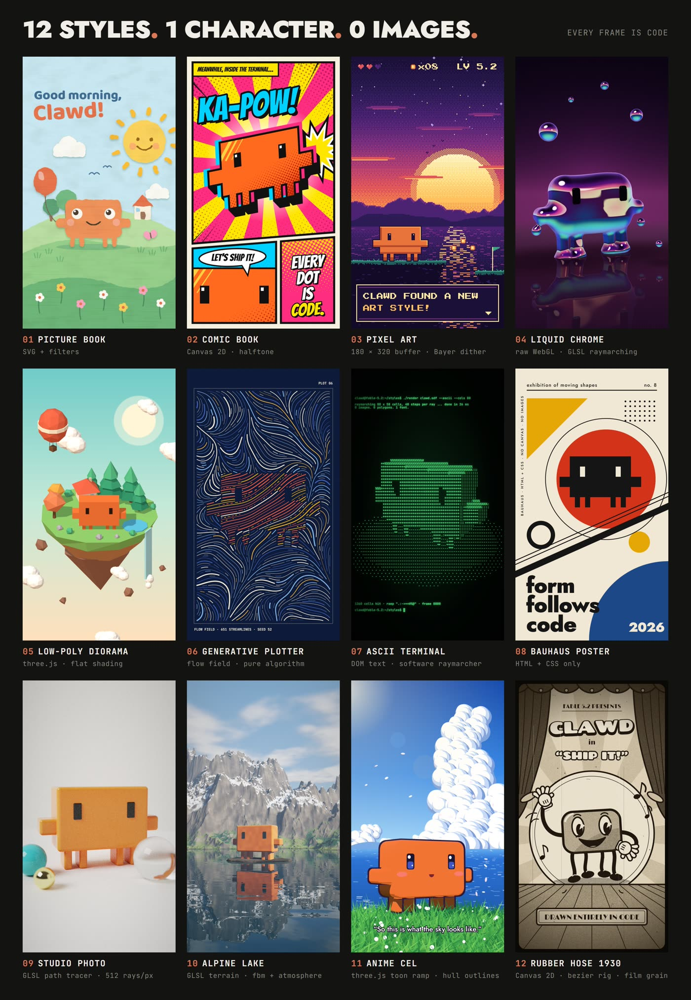
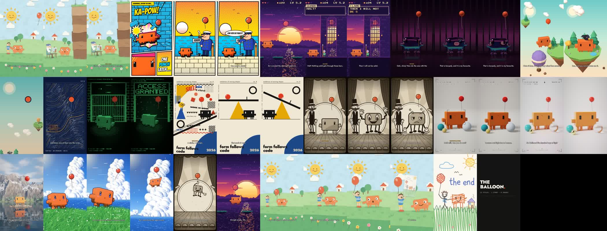

# code-cartoon

A skill for Claude Code that teaches an agent to make animated cartoons in which **every frame is drawn by code**: SVG, Canvas 2D, plain HTML and CSS, WebGL shaders and three.js, rendered to MP4 in headless Chrome. No image model and no video model draws the picture. Voices, sound effects and ambience come from ElevenLabs.

It was written while making THE BALLOON, a 2:41 short in thirteen visual styles, and the whole film is included as a working example.





## What is in here

| Path | What it is |
|---|---|
| `SKILL.md` | The workflow and the rules the agent follows |
| `references/styles.md` | A recipe for each of the thirteen styles: what makes the look, how it is built, how it moves, cost per frame, what went wrong |
| `references/story.md` | How to write one story that crosses many styles, and the "style per word" finale |
| `references/voices.md` | Voice design, emotion tags, checking every take, timing the film from the audio |
| `references/sound.md` | Per-scene effects and ambience, prompts, the mix |
| `references/checking.md` | How to check a film an agent cannot watch or hear |
| `references/parallel-build.md` | Building many scenes at once with sub-agents on a weak GPU |
| `example/` | The complete source of THE BALLOON: engine, 16 scenes, tools, script, timeline |

## The thirteen styles

Picture book (SVG cut paper) · comic book (Canvas halftone) · pixel art (180×320 buffer) · liquid chrome (raymarched shader) · low-poly (three.js) · flow field (pure algorithm) · ASCII terminal (text only) · Bauhaus poster (HTML + CSS only) · rubber hose 1930 (bezier rig and film grain) · studio photo (a path tracer in a shader) · alpine lake (raymarched terrain) · anime cel (toon shading) · a child's crayon drawing.

## Install

Copy this folder into your skills directory:

```bash
git clone https://github.com/krisuuu2/code-cartoon-skill ~/.claude/skills/code-cartoon
```

Then ask Claude Code for a cartoon, an animated story, or a style board, and it will load the skill.

## Run the example

```bash
cd example
npm install
node tools_styles8.mjs                              # the style board -> out/styles8/board.jpg
node tools_balloon.mjs --scene=book --sheet=auto    # eight stills of the first scene
node tools_balloon.mjs --video --scene=book         # that scene as video -> out/balloon/seg/book.mp4
```

You need Node 18 or newer, Google Chrome (set `CHROME_PATH` if it is not in the default Windows location), and ffmpeg on the path. A GPU helps for the shader scenes.

The recorded voices and generated sounds are not in the repository. To make them, set `ELEVENLABS_API_KEY`, install `requests numpy soundfile pyloudnorm`, and run:

```bash
python tools_balloon_vo.py      # designs the voices, records every line, rebuilds the timeline
bash balloon/final.sh           # renders every scene, generates the sound, joins and muxes
```

Re-recording changes the durations a little, so the timeline (and with it the animation timing) will shift slightly from the published film.

## Notes

- The hero of the example is Clawd, the Claude Code mascot. Use your own character in your own film.
- The fonts are loaded from Google Fonts at render time.
- Story by [@aipractically](https://www.instagram.com/aipractically) and Claude Fable 5.2. The code was written by Claude Fable 5.2.

## License

MIT. See `LICENSE`.
